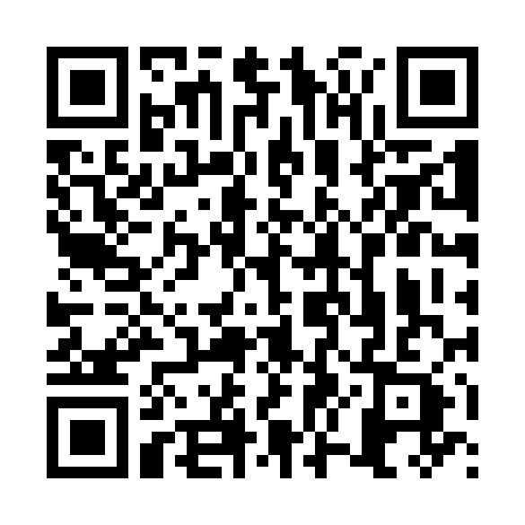

# Coleta de Campo — aplicativo Android

O mesmo `index.html` da coleta, empacotado num APK (WebView, funciona sem internet). Versão atual: **1.1**
(leitura das etiquetas QR). Para iPhone, veja [../ios/README.md](../ios/README.md).

## Instalar

Escaneie com a câmera do celular:



Link direto: <https://github.com/andersonsakuma/beemeter-coleta/releases/latest/download/coleta-de-campo.apk>

1. Abra o link e baixe o `coleta-de-campo.apk`.
2. Toque no arquivo baixado. Na primeira vez o Android pede para permitir a instalação de apps desta origem (navegador ou gerenciador de arquivos) — permita.
3. Abra **Coleta de Campo** e informe o seu nome em **Enviar → Este aparelho**.

Requer Android 7.0 (API 24) ou superior. O aplicativo pede a permissão de **Localização** só quando você toca em **Usar GPS** no cadastro da colônia. As fotos são tiradas pelo aplicativo de câmera do próprio celular. **Não há permissão de internet**: nada sai do aparelho sem que você toque em **Enviar**.

## Uso no campo

- **Hoje**: pendências do dia pelas frequências do plano de trabalho (chuva, kits, ocupação, pesagem, envio do mês).
- **Ler etiqueta QR** (em Hoje e em Coletar): abre a câmera do celular; fotografe a etiqueta da colmeia ou do kit
  e escolha a ficha, que já vem com a colônia (ou o kit) preenchida. As etiquetas estão em
  [../etiquetas/](../etiquetas/README.md).
- **Coletar**: as fichas F02 a F10. Em ocupação e pesagem, **Salvar e próxima colônia** percorre o meliponário.
- **Colônias**: cadastro (F01) e **sorteio do controle** de cada grupo, antes da troca das melgueiras.
- **Registros**: tudo o que foi salvo, para conferir ou corrigir.
- **Enviar**: planilha `.xlsx` (formato do Anexo 05a), fotos novas em `.zip` e cópia de segurança `.json`.

O botão **voltar** do Android fecha a ficha aberta (pergunta antes de descartar) e volta para a aba Hoje.

## Dados

Registros ficam no armazenamento do aplicativo e as fotos em arquivos internos dele, só naquele aparelho. Desinstalar o app apaga tudo: use **Enviar → Salvar cópia** antes. A importação de uma cópia apenas **acrescenta** ou atualiza — nunca apaga o que já existe. O cadastro das colônias é juntado campo a campo (vale o valor preenchido mais recente), para que o sorteio feito num celular não se perca no outro.

## Gerar o APK

Sem Gradle: `aapt2` (ou `aapt`) + `javac` + `d8` (ou `dx`) + `apksigner`.

```bash
export JAVA_HOME="<JDK 11 ou superior>"
export KEYSTORE="<caminho do .jks>" KSPASS="<senha>"
VERSION_CODE=2 VERSION_NAME=1.1 bash android/build.sh    # saída: android/build/coleta-de-campo.apk
```

Funciona no Git Bash do Windows com o SDK do Android Studio e no Linux (SDK oficial ou os pacotes `aapt`, `dalvik-exchange`, `zipalign`, `apksigner` e `android-sdk-platform-23` do Ubuntu). O código Java usa só a API 23, então compila com qualquer plataforma a partir dela.

O build copia o `../index.html` para os assets e grava a versão nele, então a página web continua sendo a única fonte.
O keystore fica fora do repositório. Atualizações precisam ser assinadas com a **mesma chave** (`CN=Coleta de Campo, O=IPE/FIS`), senão o Android recusa a instalação por cima; aumente `VERSION_CODE`.
